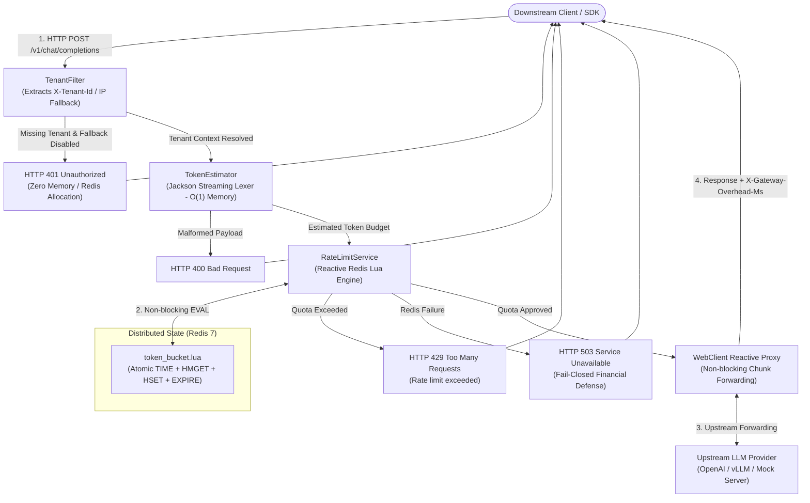

# Tenant-Aware Distributed Rate Limiter for LLM Gateways

[](https://openjdk.org/projects/jdk/21/)
[](https://spring.io/projects/spring-boot)
[](https://redis.io/)
[](https://www.docker.com/)
[](docs/BENCHMARKS.md)
[](LICENSE)

An enterprise-grade, non-blocking API Gateway built on **Java 21**, **Spring Boot WebFlux (Netty)**, and **Redis 7** that enforces multi-tenant token-bucket rate limiting based on **real-time LLM token consumption** rather than naive HTTP request counts.

Designed specifically to sit in front of LLM inference engines (such as OpenAI, Anthropic, vLLM, or Ollama) to prevent GPU compute exhaustion, eliminate token budget leakage, and guarantee zero noisy-neighbor degradation under high concurrency.

---

## ⚡ The Problem: Why Request-Based Rate Limiting Fails for LLMs

Standard API gateways (Envoy, Kong, Nginx) rate limit by **Requests Per Second (RPS)**. While effective for traditional REST microservices, RPS-based throttling is fundamentally broken for Generative AI workloads:

```
Traditional Gateway:
  Tenant A: 10 req/s  (10 × 50 tokens   =    500 tokens/s)  --> ALLOWED ✔
  Tenant B: 10 req/s  (10 × 4,000 tokens = 40,000 tokens/s) --> ALLOWED ✔  <-- GPU STARVATION & CLOUD RUNAWAY!

Tenant-Aware Token Rate Limiter:
  Tenant A:  500 tokens/s consumed  --> ALLOWED ✔
  Tenant B: 40,000 tokens/s requested --> THROTTLED (HTTP 429) ✖  <-- UPSTREAM PROTECTED!
```

### Key LLM Workload Vulnerabilities
1. **Token Asymmetry**: A single request generating 4,000 completion tokens consumes $80\times$ more compute, memory bandwidth, and financial budget than a concise 50-token query. RPS rate limiters treat them identically.
2. **GPU Compute Exhaustion**: Large prompt injections or runaway batch loops can flood inference clusters, causing GPU Out-Of-Memory (OOM) errors and quadratic Attention computation degradation.
3. **DOM Tree Memory Pressure**: Ingesting multi-megabyte chat context windows using traditional DOM tree parsers (`ObjectMapper.readTree()`) allocates massive object graphs on the JVM heap, triggering GC pauses.
4. **Noisy-Neighbor Interference**: A rogue client bursting massive token volumes monopolizes backend capacity, inducing latency spikes and timeouts for well-behaved enterprise tenants.

---

## 🏛 System Architecture

The gateway executes a high-throughput, non-blocking reactive pipeline where decisions are rendered at the edge before any downstream network traffic is dispatched:



---

## 🛠 Tech Stack & Engineering Rationale

| Component | Technology | Architectural Rationale |
| :--- | :--- | :--- |
| **Runtime & Core** | **Java 21 LTS** | High-performance virtual runtime; modern language primitives; optimized garbage collection. |
| **Reactive Framework** | **Spring Boot 3.3 WebFlux** | Event-loop non-blocking I/O (Reactor Netty). Sustains 10,000+ open connections with small memory footprint (~60MB JVM base). |
| **Distributed Engine** | **Redis 7 (Lua Scripting)** | Executes atomic token bucket logic in a single round-trip. Derives timestamps from Redis server clock (`TIME`), eliminating distributed clock drift across instances. |
| **Streaming Lexer** | **Jackson Streaming API** | Directly tokens raw byte buffers using `JsonParser`. Zero DOM tree generation, $O(1)$ memory allocation, fast `skipChildren()` past extraneous payload metadata. |
| **Client / Proxy** | **Spring WebFlux `WebClient`** | Fully reactive HTTP proxy client pipeline preserving backpressure and streaming responses without thread blocking. |
| **Containerization** | **Docker & Docker Compose** | Multi-container reproducible topology with production health checks, container isolation, and automated startup orchestration. |

---

## 📊 Performance & Concurrency Benchmarks

Empirical load testing executed with **Grafana k6** against the multi-container Docker topology on Apple Silicon (8 Cores, 8 GB RAM). See [`docs/BENCHMARKS.md`](docs/BENCHMARKS.md) for complete telemetry reports.

### Key Performance Highlights

- 🚀 **Sustained Throughput**: **2,002.31 requests/sec** under sustained 100 concurrent virtual users for 60 seconds.
- 📦 **Total Completed Requests**: **121,180 requests** with **0.00% network drop rate** (zero dropped sockets or connection resets).
- ⏱ **Gateway Processing Overhead**:
  - **p50 Latency Overhead**: **0.40 ms (400 µs)** (SLO Target: `< 2.0 ms` — **PASS**)
  - **p90 Latency Overhead**: **1.62 ms**
  - **p95 Latency Overhead**: **2.24 ms** (SLO Target: `< 5.0 ms` — **PASS**)
  - **p99 Latency Overhead**: **4.21 ms** (Tail Target: `< 15.0 ms` — **PASS**)
- 🎯 **Throttling Accuracy**: **100.00% precision** on HTTP 429 Too Many Requests rejections across 115,555 burst saturation requests.
- 🛡 **Noisy-Neighbor Isolation**: Malicious saturated traffic on Tenant A (100% 429s across 64,232 requests) caused **0% degradation** to conforming Tenant B (100% 200 OK sustained with median latency of 34.88ms).
- 🛑 **Edge Rejection Speed**: Saturated requests are rejected in a median of **2.39 ms**, shielding upstream LLMs from wasted GPU compute.

---

## 🚀 Quickstart Guide

### 1. Prerequisites
- Docker Engine 24+ & Docker Compose v2
- `curl` and `bash`

### 2. Start the Stack
Clone the repository and start the multi-container environment:

```bash
git clone https://github.com/PRAJJWALmehta/tenant-aware-distributed-rate-limiter.git
cd tenant-aware-distributed-rate-limiter

# Start Redis, Gateway, and Mock Upstream
docker compose up -d
```

Verify services are healthy:
```bash
docker compose ps
curl http://localhost:8080/health
# Returns: OK
```

### 3. Run the Automated 60-Second Demo
Run the included colorized terminal demo to verify all 6 operational stages:

```bash
bash scripts/demo.sh
```

### 4. Manual API Usage Examples

#### A. Conforming Request (200 OK)
Send a standard completion payload with 15 tokens:

```bash
curl -i -X POST http://localhost:8080/v1/chat/completions \
  -H "Content-Type: application/json" \
  -H "X-Tenant-Id: enterprise-corp" \
  -d '{
    "model": "gpt-4",
    "messages": [{"role": "user", "content": "Explain atomic clocks."}],
    "max_tokens": 15
  }'
```
*Response Header:* `X-Gateway-Overhead-Ms: 1.45`  
*Response Body:* `{"choices": [{"text": "Mock LLM response"}]}`

#### B. Inspect Token Bucket in Redis
Check the live decremented token balance:

```bash
docker compose exec -T redis redis-cli HMGET rate_limit:enterprise-corp tokens last_refill_ts
# 1) "85"
# 2) "1793958186841"
```

#### C. Quota Saturation (429 Too Many Requests)
Send a request exceeding tenant bucket capacity (default: 100):

```bash
curl -i -X POST http://localhost:8080/v1/chat/completions \
  -H "Content-Type: application/json" \
  -H "X-Tenant-Id: enterprise-corp" \
  -d '{
    "model": "gpt-4",
    "messages": [{"role": "user", "content": "Dump everything"}],
    "max_tokens": 120
  }'
```
*HTTP Status:* `429 Too Many Requests`  
*Response Body:* `Rate limit exceeded`

#### D. Untrusted Caller IP Attribution
Requests omitting `X-Tenant-Id` automatically fallback to client IP rate-limiting:

```bash
curl -i -X POST http://localhost:8080/v1/chat/completions \
  -H "Content-Type: application/json" \
  -H "X-Forwarded-For: 203.0.113.19" \
  -d '{"messages": [{"role": "user", "content": "Ping"}], "max_tokens": 10}'
```
*Redis Key Created:* `rate_limit:203.0.113.19`

---

## ⚙️ Configuration Reference

All settings can be customized via environment variables or `application.yml`:

| Property | Environment Variable | Default | Description |
| :--- | :--- | :--- | :--- |
| `server.port` | `PORT` | `8080` | Port for the Netty reactive gateway HTTP server. |
| `spring.data.redis.host` | `SPRING_DATA_REDIS_HOST` | `localhost` | Redis server hostname or container service name. |
| `spring.data.redis.port` | `SPRING_DATA_REDIS_PORT` | `6379` | Redis server port. |
| `ratelimiter.bucket.capacity` | `RATELIMITER_BUCKET_CAPACITY` | `100` | Maximum token bucket burst capacity per tenant. |
| `ratelimiter.bucket.refill-rate` | `RATELIMITER_BUCKET_REFILL_RATE` | `10` | Tokens added back to tenant bucket per second. |
| `ratelimiter.fallback.ip.enabled` | `RATELIMITER_FALLBACK_IP_ENABLED` | `true` | When true, tracks missing tenant IDs by IP; when false, rejects with 401. |
| `ratelimiter.token.fallback-buffer`| `RATELIMITER_TOKEN_FALLBACK_BUFFER` | `10` | Default buffer tokens when payload lacks `max_tokens`. |
| `upstream.url` | `UPSTREAM_URL` | `""` (empty) | Target upstream LLM provider URL. If unset, returns standalone 200 OK. |
| `spring.codec.max-in-memory-size` | `SPRING_CODEC_MAX_IN_MEMORY_SIZE` | `10MB` | WebFlux payload memory buffer limit before backpressure rejection. |

---

## 📂 Repository Layout

```
.
├── Dockerfile                          # Multi-stage Eclipse Temurin JRE container build
├── docker-compose.yml                  # Complete local stack (Gateway, Redis, Mock Upstream)
├── pom.xml                             # Maven build with Java 21, WebFlux & Redis dependencies
├── README.md                           # Flagship repository documentation
├── scripts/
│   ├── demo.sh                         # Automated 60-second interactive terminal demonstration
│   └── verify-docker.sh                # Automated Docker test suite
├── benchmarks/
│   └── k6-load-test.js                 # Grafana k6 high-concurrency load testing suite
├── docs/
│   ├── BENCHMARKS.md                   # Comprehensive benchmark telemetry and SLO report
│   ├── interview-talking-points.md     # SDE-2 interview cheat-sheet and 5-minute demo script
│   ├── PRD-tenant-rate-limiter.md      # Product Requirements Document
│   ├── plan-tenant-rate-limiter.md     # Engineering implementation checklist
│   └── architecture/
│       ├── ARCHITECTURE.md             # Deep dive architecture and technical blueprints
│       └── diagrams/                   # Mermaid sequence and flow diagrams
├── src/
│   ├── main/
│   │   ├── java/com/ratelimiter/
│   │   │   ├── GatewayApplication.java # Reactive RouterFunctions & WebClient proxy pipeline
│   │   │   ├── filter/
│   │   │   │   └── TenantFilter.java   # Reactive WebFilter for tenant & IP resolution
│   │   │   └── service/
│   │   │       ├── RateLimitService.java # Redis reactive template & Lua execution
│   │   │       └── TokenEstimator.java   # Jackson Streaming API O(1) token lexer
│   │   └── resources/
│   │       ├── application.yml         # Gateway configuration
│   │       └── scripts/
│   │           └── token_bucket.lua    # Atomic Redis token bucket script with TIME
│   └── test/                           # WebTestClient & Mockito unit/integration test suites
```

---

## 📄 License

This project is licensed under the [MIT License](LICENSE).
