# Architecture & System Design Deep Dive

This document provides a comprehensive technical breakdown of the **Tenant-Aware Distributed Rate Limiter**, detailing the system topology, reactive execution pipeline, core component responsibilities, and SDE-2 architectural trade-offs.

---

## 1. System Overview & Architectural Philosophy

Modern Large Language Model (LLM) inference infrastructure presents unique rate-limiting challenges. Traditional API gateways enforce limits based on raw **Requests Per Minute (RPM)**. However, LLM workloads exhibit extreme token asymmetry: a single request can consume between 10 tokens and 32,000+ tokens. A naive RPM gate allows a single "noisy neighbor" submitting multi-megabyte context prompts to saturate shared GPU clusters and vendor budget quotas while technically remaining within request-count thresholds.

To eliminate this vulnerability, this gateway serves as an **in-flight token-aware reverse proxy** deployed at the edge. It combines:
1. **Zero-DOM Streaming Token Estimation:** Parses token budgets directly from byte streams without loading JSON trees into the JVM heap.
2. **Atomic Single-Roundtrip Token Buckets:** Uses server-side Redis Lua scripts to update multi-tenant token allocations atomically without distributed locks.
3. **Non-Blocking Reactive Pipeline:** Employs Spring WebFlux and Reactor Netty event loops to maintain high connection concurrency with minimal operating system threads.

```
[ Client Application ]
         │
         ▼  (HTTP POST /v1/chat/completions)
┌────────────────────────────────────────────────────────┐
│ Spring WebFlux API Gateway (Port 8080)                 │
│                                                        │
│  ┌──────────────────────────────────────────────────┐  │
│  │ 1. TenantFilter                                  │  │
│  │    • Extract X-Tenant-Id or fallback to IP       │  │
│  │    • Bind tenantId to Reactor Context            │  │
│  └────────────────────────┬─────────────────────────┘  │
│                           │                            │
│  ┌────────────────────────▼─────────────────────────┐  │
│  │ 2. TokenEstimator                                │  │
│  │    • Jackson Streaming JsonParser (O(1) memory)  │  │
│  │    • Extract 'max_tokens' or prompt length       │  │
│  └────────────────────────┬─────────────────────────┘  │
│                           │                            │
│  ┌────────────────────────▼─────────────────────────┐  │
│  │ 3. RateLimitService                              │  │
│  │    • Reactive Redis Lettuce Client (EVALSHA)     │  │
│  │    • Atomic Token Bucket Deduction (Redis 7)     │  │
│  └────────────┬─────────────────────────┬───────────┘  │
└───────────────┼─────────────────────────┼──────────────┘
                │ Allowed                 │ Denied (Quota Exhausted)
                ▼                         ▼
   ┌─────────────────────────┐   ┌───────────────────────────────┐
   │ 4. WebClient Proxy      │   │ HTTP 429 Too Many Requests    │
   │    Forward to Upstream  │   │ Body: "Rate limit exceeded"   │
   │    LLM Service (8081)   │   │ X-Gateway-Overhead-Ms Header  │
   └────────────┬────────────┘   └───────────────────────────────┘
                │
                ▼
   ┌─────────────────────────┐
   │ HTTP 200 OK Response    │
   │ + Upstream Payload      │
   │ + X-Gateway-Overhead-Ms │
   └─────────────────────────┘
```

---

## 2. Request Lifecycle & Component Architecture

Incoming requests traverse an asynchronous, non-blocking pipeline orchestrated through Spring WebFlux functional endpoints and Reactor context propagation.

### Visual Request Lifecycle Diagram

```mermaid
flowchart TD
    %% Request Lifecycle and Architecture
    Client(["Client HTTP Request (POST /v1/chat/completions)"]) --> Filter["TenantFilter (WebFilter)"]

    subgraph Identity ["1. Tenant Identification Filter"]
        Filter --> CheckHeader{"Header Present?<br/>X-Tenant-Id"}
        CheckHeader -- "Yes" --> SetTenantCtx["Bind Tenant ID to Reactor Context"]
        CheckHeader -- "No" --> CheckFallback{"IP Fallback Enabled?<br/>ratelimiter.fallback.ip.enabled"}
        CheckFallback -- "Yes (true)" --> ResolveIP["Resolve Client IP<br/>(X-Forwarded-For or RemoteAddress)"]
        ResolveIP --> SetTenantCtx
        CheckFallback -- "No (false)" --> Return401["Reject: 401 Unauthorized<br/>(Missing Tenant Context)"]
    end

    subgraph Parsing ["2. Streaming Token Estimation"]
        SetTenantCtx --> TokenParser["TokenEstimator (Service)"]
        TokenParser --> ReadStream["Stream JSON Byte Array<br/>(Zero-DOM O(1) Memory)"]
        ReadStream --> ParseCheck{"Contains 'max_tokens'?"}
        ParseCheck -- "Yes" --> UseMaxTokens["Estimate = max_tokens"]
        ParseCheck -- "No" --> FallbackPrompt["Estimate = prompt.length() + defaultBuffer"]
        UseMaxTokens --> CostCalculated["Token Reservation Resolved (N)"]
        FallbackPrompt --> CostCalculated
    end

    subgraph Evaluation ["3. Atomic Distributed Rate Limiting"]
        CostCalculated --> RateService["RateLimitService (Lettuce Reactive)"]
        RateService --> RedisExec["Execute Lua Script (token_bucket.lua via EVALSHA)"]
        RedisExec --> RedisKey[("Redis Hash: rate_limit:{tenantId}<br/>- tokens<br/>- last_refill_ts")]
        RedisKey --> LuaLogic{"Current Tokens >= Requested?"}
        LuaLogic -- "Yes (allowed = 1)" --> Deduct["Atomic Decrement & Refresh TTL<br/>Return 1"]
        LuaLogic -- "No (allowed = 0)" --> RejectQuota["Retain Tokens & Refresh TTL<br/>Return 0"]
    end

    subgraph Routing ["4. Upstream Routing & Telemetry"]
        Deduct --> UpstreamCheck{"Upstream Configured?"}
        UpstreamCheck -- "Yes" --> WebClientProxy["WebClient Reactive Proxy<br/>(Forward to Upstream LLM)"]
        WebClientProxy --> UpstreamLLM[("Upstream LLM Service / Mock<br/>(port 8081)")]
        UpstreamLLM --> ComputeOverhead["Compute X-Gateway-Overhead-Ms<br/>(Total Duration - Upstream Duration)"]
        ComputeOverhead --> Client200["Return 200 OK<br/>+ Payload & X-Gateway-Overhead-Ms"]

        UpstreamCheck -- "No" --> Standalone200["Return 200 OK<br/>+ X-Gateway-Overhead-Ms"]

        RejectQuota --> Return429["Return 429 Too Many Requests<br/>+ X-Gateway-Overhead-Ms<br/>'Rate limit exceeded'"]
        RedisExec -. "Connection Failure" .-> FailOpenFallback{"Fail-Open Policy?"}
        FailOpenFallback -. "Fail-Open (Graceful Degradation)" .-> WebClientProxy
        FailOpenFallback -. "Fail-Closed" .-> Return503["Return 503 Service Unavailable"]
    end

    Return401 --> ClientResponse(["Downstream Client Response"])
    Client200 --> ClientResponse
    Standalone200 --> ClientResponse
    Return429 --> ClientResponse
    Return503 --> ClientResponse

    classDef primary fill:#e1f5fe,stroke:#0288d1,stroke-width:2px,color:#01579b;
    classDef success fill:#e8f5e9,stroke:#388e3c,stroke-width:2px,color:#1b5e20;
    classDef warning fill:#fff3e0,stroke:#f57c00,stroke-width:2px,color:#e65100;
    classDef danger fill:#ffebee,stroke:#d32f2f,stroke-width:2px,color:#b71c1c;
    classDef storage fill:#ede7f6,stroke:#512da8,stroke-width:2px,color:#311b92;

    class Filter,TokenParser,RateService,WebClientProxy primary;
    class Client200,Standalone200 success;
    class Return429,FailOpenFallback warning;
    class Return401,Return503 danger;
    class RedisKey,UpstreamLLM storage;
```



---

## 3. Component Deep Dive

### 3.1. `TenantFilter` (Identity Resolution)
- **Interface:** `org.springframework.web.server.WebFilter`
- **Execution Order:** Runs ahead of route dispatchers on every HTTP request (bypassing `/health`).
- **Identity Resolution Hierarchy:**
  1. Primary Header: Checks `X-Tenant-Id`. If present and non-blank, the value is bound into the downstream `Mono` Reactor Context under `TenantFilter.TENANT_KEY`.
  2. Fallback IP Check: If `X-Tenant-Id` is missing, the filter verifies the configuration toggle `ratelimiter.fallback.ip.enabled` (default `true`).
  3. Proxy Forward Header: If fallback is enabled, parses the leftmost IP in `X-Forwarded-For`.
  4. Socket Address: Resolves `request.getRemoteAddress().getAddress().getHostAddress()`.
  5. Security Gate: If fallback is disabled (`ratelimiter.fallback.ip.enabled=false`) and `X-Tenant-Id` is absent, the filter immediately short-circuits with **HTTP 401 Unauthorized**, skipping all subsequent downstream parsing and Redis evaluations.

### 3.2. `TokenEstimator` (Streaming In-Memory Lexer)
- **Interface:** Non-blocking service utilizing Jackson Streaming API (`JsonFactory` and `JsonParser`).
- **Parsing Strategy:**
  - Ingests incoming request bytes as an input stream.
  - Traverses JSON tokens at the root object level without constructing an object tree.
  - Matches `"max_tokens"` numeric scalar values immediately.
  - If `"prompt"` is encountered, extracts the string reference.
  - Uses `parser.skipChildren()` for any nested object or array tokens, skipping extraneous payload structures (such as nested message histories or tools definitions) in constant time.
- **Cost Calculation Algorithm:**
  ```java
  if (maxTokens != null) {
      return maxTokens;
  }
  int promptLength = (prompt != null) ? prompt.length() : 0;
  return promptLength + defaultBuffer;
  ```
- **Error Handling:** Malformed JSON structures throw `IllegalArgumentException`, resulting in an instant **HTTP 400 Bad Request** before Redis resources are accessed.

### 3.3. `RateLimitService` (Reactive Redis Engine)
- **Interface:** Asynchronous token bucket evaluator backed by Spring `ReactiveRedisTemplate<String, String>`.
- **Script Loading:** Pre-loads `scripts/token_bucket.lua` as a `DefaultRedisScript<Long>` at bean initialization, executing in Redis via `EVALSHA` to avoid re-transmitting Lua script text over the network.
- **Redis Data Structure:** Uses a Redis Hash located at key `rate_limit:{tenantId}`:
  - `tokens`: Float/Integer representing available token capacity.
  - `last_refill_ts`: Unix millisecond timestamp when the bucket was last recalculated.
- **TTL Expiration Policy:** Every script invocation sets a sliding TTL:
  $$\text{TTL} = \max\left(3600,\; 2 \times \left\lceil \frac{\text{capacity}}{\text{refill\_rate}} \right\rceil\right)$$
  This guarantees that inactive tenant keys automatically expire, preventing unbounded memory growth in Redis.

### 3.4. `GatewayApplication` (Reactive Routing & Overhead Telemetry)
- **Interface:** Functional routing via `RouterFunctions.route(POST("/**"), ...)`.
- **Overhead Telemetry Calculation:**
  The gateway measures pure gateway overhead by isolating proxy traversal and Redis latency from upstream LLM processing time:
  $$\text{Overhead} = \max(0,\; \text{Duration}_{\text{total}} - \text{Duration}_{\text{upstream}})$$
  The computed value is converted to fractional milliseconds and injected into downstream response headers:
  `X-Gateway-Overhead-Ms: 1.42`.

---

## 4. Sequence Flows & Operational Scenarios

The diagram below captures all four primary execution paths through the system.

```mermaid
sequenceDiagram
    autonumber
    actor Client as Client Application
    participant TF as TenantFilter
    participant GW as GatewayApplication
    participant TE as TokenEstimator
    participant RLS as RateLimitService
    participant Redis as Redis (token_bucket.lua)
    participant Upstream as Upstream LLM Router / Mock

    %% Sequence 1: Happy Path
    rect rgb(232, 245, 233)
    Note over Client, Upstream: Sequence 1: Happy Path (200 OK + Token Deduction)
    Client->>TF: POST /v1/chat/completions (X-Tenant-Id: tenant-a, max_tokens: 25)
    TF->>TF: Extract X-Tenant-Id header ('tenant-a')
    TF->>GW: Forward exchange with Context(tenantId = 'tenant-a')
    GW->>TE: estimate(bodyBytes)
    TE-->>GW: Estimated tokens = 25
    GW->>RLS: isAllowed("tenant-a", 25)
    RLS->>Redis: EVALSHA token_bucket.lua (keys=[rate_limit:tenant-a], args=[25, 100, 10])
    Redis-->>RLS: 1 (Tokens deducted: balance decreases from 100 to 75)
    RLS-->>GW: Mono.just(true)
    GW->>Upstream: WebClient.POST /v1/chat/completions (stream body)
    Upstream-->>GW: 200 OK ({"choices": [{"text": "Mock LLM response"}]})
    GW->>GW: Compute overhead: totalDuration - upstreamDuration
    GW-->>Client: 200 OK + LLM Response Body + X-Gateway-Overhead-Ms: 1.42
    end

    %% Sequence 2: Budget Exhausted
    rect rgb(255, 243, 224)
    Note over Client, Upstream: Sequence 2: Budget Exhausted (429 Too Many Requests)
    Client->>TF: POST /v1/chat/completions (X-Tenant-Id: tenant-b, max_tokens: 50)
    TF->>TF: Extract X-Tenant-Id header ('tenant-b')
    TF->>GW: Forward exchange with Context(tenantId = 'tenant-b')
    GW->>TE: estimate(bodyBytes)
    TE-->>GW: Estimated tokens = 50
    GW->>RLS: isAllowed("tenant-b", 50)
    RLS->>Redis: EVALSHA token_bucket.lua (keys=[rate_limit:tenant-b], args=[50, 100, 10])
    Note over Redis: Current tokens (20) < Requested (50) -> Quota Denied
    Redis-->>RLS: 0 (No tokens deducted; balance remains 20)
    RLS-->>GW: Mono.just(false)
    GW->>GW: Short-circuit (upstream request aborted)
    GW-->>Client: 429 Too Many Requests ("Rate limit exceeded" + X-Gateway-Overhead-Ms)
    end

    %% Sequence 3: Missing Tenant Header with IP Fallback Disabled
    rect rgb(255, 235, 238)
    Note over Client, Upstream: Sequence 3: Missing Tenant Header with IP Fallback Disabled (401 Unauthorized)
    Client->>TF: POST /v1/chat/completions (No X-Tenant-Id header)
    TF->>TF: Check ratelimiter.fallback.ip.enabled == false
    TF-->>Client: 401 Unauthorized (Pipeline halted immediately; 0 memory parsing, 0 Redis queries)
    end

    %% Sequence 4: Redis Connection Failure (Fail-Open Path)
    rect rgb(225, 245, 254)
    Note over Client, Upstream: Sequence 4: Redis Connection Failure (Graceful Degradation / Fail-Open)
    Client->>TF: POST /v1/chat/completions (X-Tenant-Id: tenant-c, max_tokens: 30)
    TF->>TF: Extract X-Tenant-Id header ('tenant-c')
    TF->>GW: Forward exchange with Context(tenantId = 'tenant-c')
    GW->>TE: estimate(bodyBytes)
    TE-->>GW: Estimated tokens = 30
    GW->>RLS: isAllowed("tenant-c", 30)
    RLS->>Redis: EVALSHA token_bucket.lua
    Redis--xRLS: RedisConnectionException / Network Timeout
    RLS-->>GW: Mono.error(RedisConnectionException)
    GW->>GW: Fallback: Fail-Open Resilience Circuit
    Note over GW: Log WARN: Redis cluster degraded. Failing open to protect upstream availability.
    GW->>Upstream: WebClient.POST /v1/chat/completions (proxy upstream)
    Upstream-->>GW: 200 OK ({"choices": [...]})
    GW->>GW: Attach X-Gateway-Overhead-Ms + X-RateLimit-Degraded: true
    GW-->>Client: 200 OK + LLM Response Body + Degraded Telemetry Header
    end
```

---

## 5. Core SDE-2 Engineering Decisions & Trade-Offs

### 5.1. Trade-Off 1: Memory Safety & Payload Streaming
#### `JsonParser` Streaming ($O(1)$ Memory) vs `ObjectMapper.readTree()` ($O(N)$ Heap Allocation)

In an API Gateway handling high-concurrency LLM traffic, payload bodies can range from small conversational turns (1 KB) to massive context windows (100 KB - 5 MB+ with documents, embeddings, or code repositories).

```
Approach A: ObjectMapper.readTree() / DOM Tree
┌────────────────────────────────────────────────────────┐
│ Payload: 256 KB JSON                                   │
│  ├── JsonNode (Root ObjectNode)                        │
│  │   ├── TextNode "model": "gpt-4o"                    │
│  │   ├── ArrayNode "messages" (100 objects)            │
│  │   │    └── TextNode "content" (Hundreds of KB)      │
│  │   └── IntNode "max_tokens": 100                     │
│ Heap Memory Allocated: ~1.2 MB to 2.5 MB per request   │
│ 10,000 Concurrent Requests = ~15 GB to 25 GB Heap Churn│
│ Outcome: GC Pauses (Stop-The-World), OutOfMemoryError  │
└────────────────────────────────────────────────────────┘

Approach B: Jackson Streaming JsonParser (Selected)
┌────────────────────────────────────────────────────────┐
│ Payload: 256 KB JSON Byte Buffer                       │
│  ├── START_OBJECT Token                                │
│  ├── FIELD_NAME "max_tokens" -> VALUE_NUMBER 100       │
│  └── parser.skipChildren() for remaining tokens        │
│ Heap Memory Allocated: ~4 KB to 8 KB buffer            │
│ 10,000 Concurrent Requests = ~40 MB to 80 MB Total     │
│ Outcome: Zero DOM Allocations, Flat Heap, Near-Zero GC │
└────────────────────────────────────────────────────────┘
```

#### Detailed Comparison Matrix:

| Dimension | `ObjectMapper.readTree()` / DOM | Streaming `JsonParser` (Implemented) |
|---|---|---|
| **Memory Complexity** | $O(N)$ where $N$ is payload size | $O(1)$ constant internal ring buffer (~8 KB) |
| **Object Allocations** | Hundreds of `JsonNode`, `TextNode`, `Entry` instances | 0 intermediate tree nodes; primitive scalar read |
| **Heap Churn under Load** | Extreme (10k conns $\times$ 500 KB = 5 GB to 10 GB heap churn) | Minimal (10k conns $\times$ 8 KB buffer = ~80 MB) |
| **Garbage Collector Impact** | Frequent Young-Gen collections, G1 STW GC spikes | Near-zero garbage generation; stable Eden generation |
| **Execution Speed** | Parses every key, value, and nested child array | Scans root scalars and skips children immediately |
| **Security Surface** | Vulnerable to HashDOS and JSON deep recursion bombs | Safe: Depth-restricted parsing without tree nesting |

---

### 5.2. Trade-Off 2: Atomicity & Concurrency Control
#### Single Redis Lua Script vs Distributed Locks (Redlock / ZooKeeper)

To enforce accurate token rate limiting across multiple gateway replicas, token deduction must be strictly atomic. The system must prevent **Time-Of-Check to Time-Of-Use (TOCTOU)** race conditions where concurrent requests concurrently read the same balance and spend more tokens than permitted.

```
Approach A: Distributed Locking (Redlock / Two-Phase Locking)
Gateway Instance 1             Redis Cluster / Lock Manager
       │                                     │
       │─── 1. Acquire Distributed Lock ────►│ (Network Roundtrip 1)
       │◄── Lock Granted (TTL = 100ms) ──────│
       │─── 2. GET current token balance ───►│ (Network Roundtrip 2)
       │◄── Return balance (e.g., 50) ───────│
       │    [Compute: 50 >= 30 -> 20 left]   │
       │─── 3. SET new balance (20) ────────►│ (Network Roundtrip 3)
       │◄── OK ──────────────────────────────│
       │─── 4. Release Distributed Lock ────►│ (Network Roundtrip 4)
       │◄── Released ────────────────────────│
Total Cost: 4 Network Hops (~4-15ms) + Lock Contention Serialization!

Approach B: Single Redis Lua Script (Selected)
Gateway Instance 1                           Redis Engine
       │                                           │
       │─── EVALSHA token_bucket.lua (1 Hop) ─────►│
       │    [Calculates refill using redis TIME]   │
       │    [Atomically compares & deducts tokens] │
       │    [Persists hash & updates sliding TTL]  │
       │◄── Return 1 (allowed) or 0 (denied) ──────│
Total Cost: 1 Network Hop (< 1ms overhead) + Complete Single-Threaded Isolation!
```

#### Detailed Comparison Matrix:

| Evaluation Criteria | Distributed Locks (Redlock) | Single Redis Lua Script (Implemented) |
|---|---|---|
| **Network Roundtrips** | 3 to 4 distinct roundtrips per request | **1 single roundtrip** via `EVALSHA` |
| **Overhead Latency** | 4ms to 20ms added latency per request | **< 1ms** script execution latency |
| **Lock Contention** | High lock contention under bursts on same tenant | Lock-free; Redis executes sequentially in-memory |
| **Failure Modes** | Lock leaks on node crash, lease expiration races | Atomic transaction; no partial state or orphan locks |
| **Clock Synchronization** | Requires synced NTP across all gateway nodes | Uses Redis server internal clock (`redis.call('TIME')`) |
| **Infrastructure Overhead**| Requires lock managers, heartbeat lease renewal | Leverages existing Redis cluster without extra tools |

---

### 5.3. Trade-Off 3: Reactive Event-Loop Pipeline vs Blocking Thread-per-Request
#### Spring WebFlux / Reactor Netty vs Traditional Spring MVC / Servlet (Tomcat)

In LLM API Gateways, request durations are dominated by upstream inference. While traditional microservices respond in 20ms to 100ms, LLM text generation frequently runs for **2,000ms to 60,000ms+** for long streaming responses.

```
Approach A: Blocking Servlet (Tomcat Thread-Per-Request)
Request 1 ──► [Thread 1] ──► Blocked waiting on LLM (5,000ms) ──► Exhausted
Request 2 ──► [Thread 2] ──► Blocked waiting on LLM (8,000ms) ──► Exhausted
...
Request 200 ─► [Thread 200] ─► Blocked waiting on LLM (3,000ms) ──► Thread Pool Depleted!
Request 201 ─► Queue Full ──► HTTP 503 / Connection Refused / Out of Memory
Memory Cost: 200 threads * 1 MB stack = 200 MB; 10,000 threads = 10 GB heap just for stacks!

Approach B: Non-Blocking Reactive WebFlux (Reactor Netty)
Request 1   ┐
Request 2   ├─► [ Netty Event Loop (16 threads) ] ──► Non-blocking I/O multiplexing
...         │   Registers socket channels via epoll/kqueue.
Request 10k ┘   Threads never block; handles 100,000+ open connections with ~64 MB RAM!
```

#### Detailed Comparison Matrix:

| Dimension | Blocking Servlet (Spring MVC) | Reactive WebFlux / Netty (Implemented) |
|---|---|---|
| **Threading Model** | 1 OS thread per concurrent connection | $2 \times \text{CPU cores}$ event loops (~16 threads on Apple M2/x86) |
| **Memory per Connection** | ~1 MB stack space per thread | ~2 KB per connection state channel |
| **Context Switching** | High OS kernel thread switching overhead | Zero context switching; threads run continuously |
| **Slow Upstream Resilience**| Gateway collapses under slow upstream inference | Gracefully holds tens of thousands of open sockets |
| **Backpressure Support** | None (OS TCP buffer backpressure only) | Reactive Streams `Flux`/`Mono` specification |

---

## 6. Resilience, Failure Modes & Edge Case Strategies

```
┌────────────────────────────────┬───────────────────────────────────────────────────────┐
│ Failure Mode / Condition       │ System Mitigation Strategy                            │
├────────────────────────────────┼───────────────────────────────────────────────────────┤
│ Redis Outage / Network Timeout │ Graceful Fail-Open: Logs warning, attaches degraded   │
│                                │ telemetry header, and proxies traffic to prevent      │
│                                │ gateway from cascading into an upstream outage.       │
├────────────────────────────────┼───────────────────────────────────────────────────────┤
│ Malformed / Truncated JSON     │ Immediate 400 Bad Request at TokenEstimator stage,   │
│                                │ avoiding unnecessary Redis quota reservations.        │
├────────────────────────────────┼───────────────────────────────────────────────────────┤
│ Missing Identity Header        │ Evaluates ratelimiter.fallback.ip.enabled; if true,   │
│                                │ maps to X-Forwarded-For or socket IP. If false,       │
│                                │ immediately returns 401 Unauthorized.                 │
├────────────────────────────────┼───────────────────────────────────────────────────────┤
│ Distributed Clock Drift        │ Uses Redis server internal TIME (seconds + micros),   │
│                                │ eliminating reliance on desynchronized gateway nodes. │
├────────────────────────────────┼───────────────────────────────────────────────────────┤
│ Memory Exhaustion / Idle Keys  │ Computes dynamic TTL in Lua script; inactive tenant   │
│                                │ buckets expire automatically after max(3600, 2*fill). │
└────────────────────────────────┴───────────────────────────────────────────────────────┘
```

---

## 7. Performance & Latency Telemetry Verification

During empirical k6 load testing on an 8-core Apple M2 Silicon host (see [`docs/BENCHMARKS.md`](file:///Users/prajjwalmehta/Development/Personal/tenant-aware-distributed-rate-limiter/docs/BENCHMARKS.md) for full benchmark outputs):
- **Throughput Sustained:** **2,002 RPS** across concurrent tenants.
- **Gateway Overhead (p50):** **1.15 ms**.
- **Gateway Overhead (p95):** **3.42 ms** (Satisfies the < 5.0 ms SLA target).
- **Gateway Overhead (p99):** **4.88 ms** (Zero SLA breaches).
- **Throttling Accuracy:** 100.00% assertion pass rate for HTTP 429 status code returns on saturated tenants with zero token bucket leakage.
